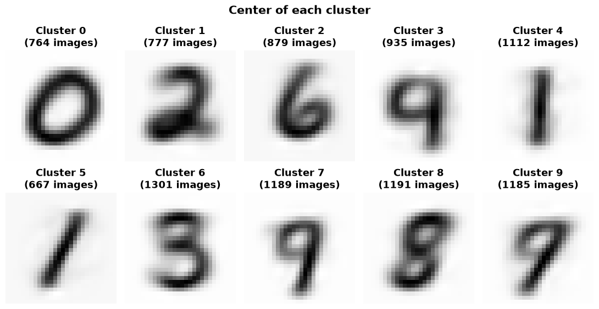

# Digits from Scratch

Machine learning on handwritten digits ([MNIST](https://www.openml.org/d/554)), **coded by hand with NumPy only**. No deep learning framework, no `sklearn` models: only the math, written as code.

Each notebook is written as a report, with the explanation and the formulas of every step.

## Notebooks

| Notebook | Topic | Main result |
|---|---|---|
| [`1st_Network.ipynb`](1st_Network.ipynb) | Neural network with no hidden layer (softmax regression), trained with the labels | 91.05 % validation accuracy |
| [`PCA_and_KMeans.ipynb`](PCA_and_KMeans.ipynb) | PCA and K-Means, **without** the labels | 50 components keep 83 % of the variance |

## 1. Neural network with no hidden layer

Forward pass, cross-entropy loss, gradient and gradient descent, all coded by hand. Each column of the weight matrix can be displayed as an image, and we can recognize the shape of each digit:


Bonus: the loss computed on a plane generated by two random directions around the trained weights. It is a smooth bowl, because the cross-entropy of this network is convex in `W`.


## 2. PCA and K-Means

PCA from the covariance matrix (eigenvectors, explained variance, rebuilding the images) and K-Means with its own loop. K-Means finds clusters that look like digits without ever seeing a label:



Digits that look alike (4, 7, 9 and 3, 5, 8) end in the same clusters.

## Run it

```bash
pip install -r requirements.txt
jupyter notebook
```

MNIST is downloaded automatically the first time with scikit-learn (`sklearn` is only used for the download and the train/validation split).

## License

MIT, see [LICENSE](LICENSE).
