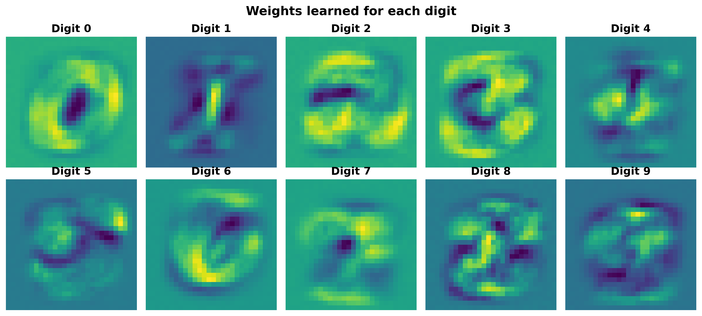
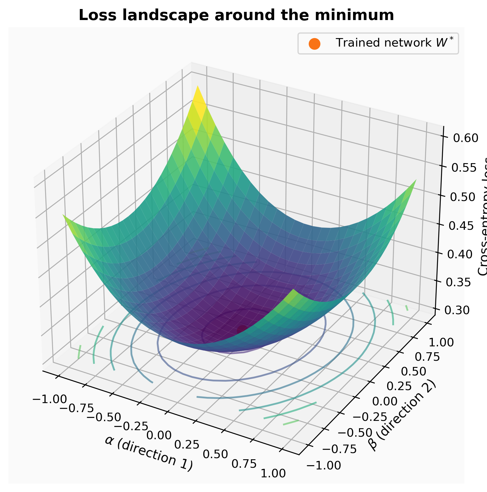

# Digit Recognition with a Neural Network (NumPy only)

A neural network with **no hidden layer** (softmax regression) that recognizes handwritten digits from the [MNIST](https://www.openml.org/d/554) dataset. Everything is coded by hand with NumPy: the forward pass, the cross-entropy loss, the gradient and the gradient descent.

The notebook is written as a report: each step has its explanation and its formulas.

## Results

- **Validation accuracy: 91.05 %** (training accuracy: 91.71 %)
- 70,000 images, split 80 % training / 20 % validation (stratified)

### What the network learned
Each column of the weight matrix can be displayed as a 28 x 28 image. We can recognize the shape of each digit in its own template.



### Bonus: the loss landscape
The loss computed on a plane generated by two random directions around the trained weights. It is a smooth bowl, because the cross-entropy of this network is convex in `W`.



## What is inside the notebook

1. Objective and data
2. The model: one-hot encoding, softmax, forward pass, cross-entropy loss, gradient
3. Training, with a live plot of the training and validation loss
4. Results: accuracy and weights as images
5. Bonus: 3D plot of the loss around the minimum

## Run it

```bash
pip install -r requirements.txt
jupyter notebook 1st_Network.ipynb
```

MNIST is downloaded automatically the first time with scikit-learn.

## License

MIT, see [LICENSE](LICENSE).
